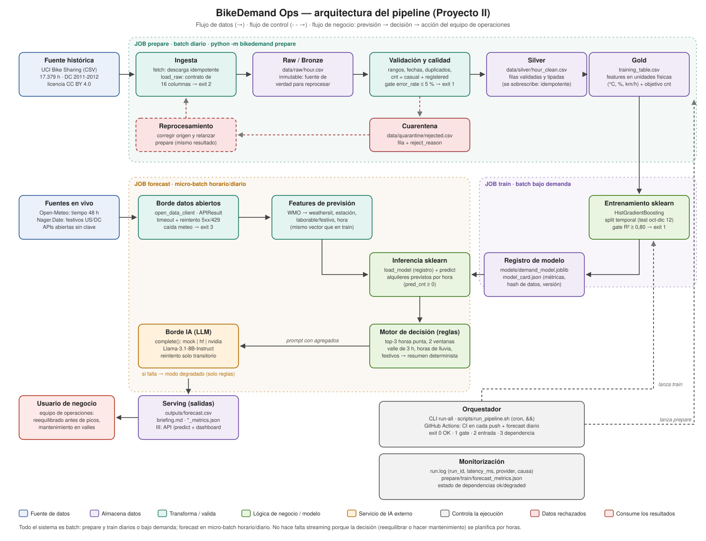
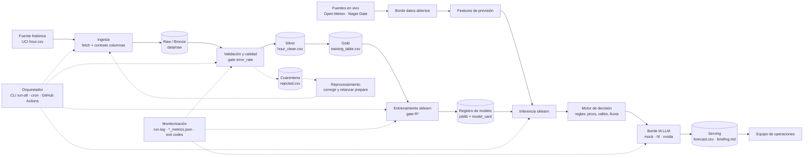

# Proyecto II — BikeDemand Ops

**Previsión horaria de la demanda de bicicleta compartida + briefing operativo con IA**

Autor: Guillermo Zapata Cassinello · DSIA 2026-2027

Pipeline automatizado que combina dos piezas distintas:

1. **Modelo scikit-learn entrenado localmente** (`HistGradientBoostingRegressor`), que predice cuántas bicis se alquilarán cada hora a partir del calendario y del tiempo.
2. **LLM vía API** (NVIDIA API Catalog con `nvidia/nemotron-3.5-bolt-e4b`), que convierte la previsión en un **briefing operativo** con el fin de compartirlo con el supuesto equipo de reequilibrado y mantenimiento de las bicis.

Para predecir las próximas 48 h, el pipeline consulta además dos **APIs abiertas sin clave**: Open-Meteo (tiempo previsto) y Nager.Date (festivos).

```text
datos UCI → prepare (bronze → silver → gold) → train (sklearn + gate) → forecast:
Open-Meteo + Nager.Date → features → predicción sklearn → reglas → LLM (mock | hf | nvidia) → informe
```

---

## 1. Dominio, datos y motivación

| | |
|---|---|
| **Problema de negocio** | En un sistema de bicicleta compartida, el equipo de operaciones decide cada día **cuándo mover bicicletas entre estaciones** (antes de los picos de demanda) y **cuándo hacer mantenimiento** (en las horas de baja demanda). Si lo planifica sin previsión, puede llega tarde a los picos y retira bicis en horas de demanda. |
| **Continuidad con el Proyecto I** | En el Proyecto I se trabajó con el estado en tiempo real de CitiBike NYC. Para entrenar un modelo hace falta un **histórico etiquetado**, así que en el II se cambió a la demanda horaria. El tema (movilidad en bici) se mantiene. |
| **Dataset** | [Bike Sharing Dataset — UCI Machine Learning Repository](https://archive.ics.uci.edu/dataset/275/bike+sharing+dataset) (`data/raw/hour.csv`): 17.379 horas de alquileres de Capital Bikeshare (Washington DC, 2011-2012) con tiempo, calendario y festivos. |
| **Licencia** | CC BY 4.0. Cita: Fanaee-T, H. (2013). *Bike Sharing* [Dataset]. UCI Machine Learning Repository. https://doi.org/10.24432/C5W894. El Readme original (con la cita del artículo) está en `data/raw/Readme_UCI.txt`. |
| **APIs de enriquecimiento** | [Open-Meteo](https://open-meteo.com/) (previsión horaria, sin clave) · [Nager.Date](https://date.nager.at/) (festivos de EE. UU., sin clave). |
| **Limitación conocida** | El histórico es de 2011-2012. Para predecir hoy se usa el último nivel de uso conocido (`system_year = 1`). En el Proyecto III el plan es reentrenar con datos recientes del mismo operador (Capital Bikeshare publica sus viajes mensualmente). |

## 2. Arquitectura



Versión Mermaid:



### Qué hace cada componente

| Componente | Tipo | Batch / streaming | Qué hace |
|---|---|---|---|
| Fuente histórica (UCI) | fuente | batch | CSV horario con alquileres (`cnt`), tiempo y calendario. |
| Ingesta (`pipeline/ingest.py`) | transforma | batch | `fetch` descarga el zip de UCI de forma idempotente. `load_raw` comprueba el **contrato de 16 columnas** y, si falla, sale con exit 2. |
| Raw / Bronze (`data/raw/`) | almacena | — | Copia inmutable del origen: es la fuente de verdad para reprocesar. |
| Validación y calidad (`pipeline/quality.py`) | transforma + control | batch | Comprueba rangos, fechas, duplicados y `cnt = casual + registered`. Las filas malas van a cuarentena con su motivo. Si `error_rate > MAX_ERROR_RATE`, sale con **exit 1** y no publica nada. |
| Cuarentena → reprocesamiento | almacena | batch | `rejected.csv` con `reject_reason`. Se corrige el origen y se relanza `prepare`, que es idempotente. |
| Silver / Gold (`data/silver`, `data/gold`) | almacena | — | Silver: datos validados. Gold: features en unidades físicas (°C, %, km/h) + objetivo. |
| Entrenamiento (`pipeline/model.py`) | lógica de negocio | batch bajo demanda | Split **temporal** y comparación con una línea base. Si el R² es menor que `MIN_R2`, sale con **exit 1** y el modelo **no se promociona** (no sobrescribe al de producción). |
| Registro de modelo (`models/`) | almacena | — | `demand_model.joblib` + `model_card.json` (métricas, hash de datos, versión de sklearn). |
| Borde datos abiertos (`integrations/open_data_client.py`) | transforma | micro-batch | Open-Meteo + Nager.Date con `timeout`. Reintenta 429/5xx/timeout, nunca 4xx. Devuelve `APIResult`. |
| Inferencia + motor de decisión (`jobs.py`) | lógica de negocio | micro-batch | Predice `pred_cnt` por hora y calcula las 3 horas punta, 2 ventanas valle de 3 h, las horas con lluvia y los festivos. |
| Borde IA (`integrations/ai_client.py`) | servicio externo | micro-batch | `complete(provider, prompt) → AIResponse`. Redacta el briefing. Si falla, el job **no se cae**: estado `degraded` y solo resumen por reglas. |
| Serving (`outputs/`) | almacena / consume | — | `forecast.csv`, `briefing.md` y `forecast_metrics.json`. En el III lo servirán la API y el dashboard. |
| Orquestador | control | — | `run-all`, `scripts/run_pipeline.sh` (cron, `&&`) y GitHub Actions (CI en cada push + forecast diario). |
| Monitorización | control | — | `run.log` con `run_id`, `latency_ms` y `provider`; métricas JSON por job; estado de cada dependencia; exit codes. |

**Flujo de negocio:** la previsión dice *cuándo* habrá picos y valles. Las reglas lo traducen en acciones concretas (reequilibrar 1 h antes del pico, mantenimiento en la ventana valle) y el LLM lo redacta para el equipo. Todo es **batch**: la decisión se planifica por horas, así que no hace falta streaming.

## 3. Modelo scikit-learn

| | |
|---|---|
| Tarea | Regresión: alquileres por hora (`cnt`) |
| Estimador | `HistGradientBoostingRegressor(max_iter=400, learning_rate=0.08, random_state=42)` |
| Features | `system_year, season, mnth, hr, holiday, weekday, workingday, weathersit, temp_c, feels_like_c, humidity_pct, wind_kmh` |
| Validación | Split temporal: entrenamiento hasta el 30/09/2012 (15.211 h) y test del 01/10/2012 al 31/12/2012 (2.168 h) |
| Línea base | Media histórica por (hora, laborable): lo que haría un planificador sin modelo |
| Persistencia | `models/demand_model.joblib` + `models/model_card.json` |
| Producción | Tras evaluar, se reentrena con todo el histórico. Las métricas publicadas son las del test |

### Métricas (test oct-dic 2012)

| | MAE | RMSE | R² |
|---|---|---|---|
| **Modelo** | **41,7** | **66,0** | **0,893** |
| Línea base | 80,0 | 119,6 | 0,648 |

El modelo **reduce el error medio a la mitad** respecto a la línea base. Por importancia de permutación (subida del MAE), lo que más pesa es la hora (`hr`), seguida de laborable o no (`workingday`) y la temperatura. `system_year` sale con 0 en el test porque todo el test es de 2012, pero en entrenamiento sí capta el crecimiento del 63 % entre 2011 y 2012.

Elegí este modelo tras comparar en el mismo split: RandomForest (R² 0,871), HGB con `log1p` en el objetivo (0,890) y HGB sin `system_year` (0,655).

Para reentrenar: `python -m bikedemand prepare && python -m bikedemand train`. Es reproducible: mismos datos y `random_state` → mismo modelo (el hash de datos queda en `model_card.json`).

## 4. Borde de IA (API de modelos)

| | |
|---|---|
| **Tarea** | `chat_completion` (LLM instruct) |
| **Modelos** | `nvidia`: `nvidia/nemotron-3.5-bolt-e4b` (modelo de texto compacto de NVIDIA para chat, endpoint gratuito; razonamiento desactivado con `chat_template_kwargs.enable_thinking=false`) · `hf`: modelo del Hub [`meta-llama/Llama-3.1-8B-Instruct`](https://huggingface.co/meta-llama/Llama-3.1-8B-Instruct) |
| **Para qué** | Post-proceso de la predicción de sklearn: recibe solo **agregados** (horas punta, valles, lluvia, festivos) y redacta un briefing de ≤150 palabras. **No predice nada** y el prompt le prohíbe inventar cifras. |
| **Proveedores** | `mock` (por defecto; **es el que se usa en tests y CI**) · `hf` (Hugging Face `InferenceClient(provider="auto").chat_completion`, `HF_TOKEN`) · `nvidia` (API Catalog de NVIDIA, endpoint `https://integrate.api.nvidia.com/v1/chat/completions` compatible con OpenAI, `NVIDIA_API_KEY`) |
| **Por qué dos proveedores reales** | HF es el proveedor recomendado del curso, pero en las cuentas gratuitas sus créditos de Inference Providers son mínimos o inexistentes. NVIDIA da una clave gratuita, así que es el proveedor real que se usa en la práctica. Cambiar de uno a otro es solo `AI_PROVIDER=...` (y de modelo, `NVIDIA_MODEL=` / `HF_MODEL=`). |
| **Por qué Bolt** | La tarea es redactar ~150 palabras a partir de datos ya calculados: basta un modelo de texto pequeño y rápido. Los modelos grandes (Ultra 550B, Super 120B) solo añaden latencia y riesgo de 429. Como Bolt razona por defecto, se desactiva el razonamiento y, por seguridad, el cliente elimina cualquier bloque `<think>…</think>` de la respuesta. |
| **Contrato** | `complete(provider, prompt, system=..., config=...) → AIResponse(provider, text, model, latency_ms)` y errores tipados `AIClientError(transient=...)` |
| **Errores** | 401/403 → no se reintenta (credenciales). 429/5xx/timeout → hasta 3 intentos con backoff 0,5 s → 1 s. Respuesta vacía o mal formada → error. |
| **Prompts** | Versionados en `integrations/prompts.py` (`briefing-v1`). No llevan datos personales y en el log solo se registra su longitud. |

Para usar un proveedor real:

```bash
cp .env.example .env          # rellena NVIDIA_API_KEY (gratis en build.nvidia.com) o HF_TOKEN
python -m bikedemand forecast --provider nvidia
```

## 5. Uso

```bash
cd Proyecto_II
python -m venv .venv && source .venv/bin/activate      # Windows: .venv\Scripts\activate
pip install -r requirements.txt

python -m bikedemand fetch                 # (opcional) descarga UCI; el CSV ya está versionado
python -m bikedemand prepare               # raw → silver/cuarentena → gold   (+ outputs/prepare_metrics.json)
python -m bikedemand train                 # modelo + model_card               (+ outputs/train_metrics.json)
python -m bikedemand forecast              # próximas 48 h + briefing          (outputs/briefing.md, forecast.csv)
python -m bikedemand run-all               # las tres etapas encadenadas
./scripts/run_pipeline.sh                  # wrapper listo para cron
```

Flags útiles: `--output-dir`, `--log-level`, `prepare --max-error-rate 0.05`, `train --min-r2 0.8 --test-from 2012-10-01`, `forecast --provider mock|hf|nvidia --hours 48`.

| Exit | Significado | Ejemplo |
|---|---|---|
| `0` | OK (también si una dependencia opcional quedó `degraded`) | previsión generada |
| `1` | Gate de calidad | `error_rate` > umbral o R² < `MIN_R2` |
| `2` | Entrada o configuración inválida | falta el CSV o una columna, no hay modelo, `AI_PROVIDER=nvidia` sin clave |
| `3` | Dependencia externa caída | Open-Meteo no responde tras los reintentos |

Ejemplo de salida: [`docs/ejemplo_briefing.md`](docs/ejemplo_briefing.md).

## 6. Robustez

- **Configuración** centralizada en `config.py` (`Settings`, `.env`). Se valida al arrancar: un proveedor desconocido o uno real sin clave sale con exit 2.
- **Errores tipados** (`errors.py`): `QualityGateError`, `DataContractError`, `ModelNotFoundError`, `UpstreamError`, `OpenAPIError`, `AIClientError`. Cada uno tiene su exit code, y en el Proyecto III tendrá su código HTTP.
- **Degradación controlada:** si fallan los festivos, se asume que no hay ninguno; si falla la IA, el informe sale solo con el resumen por reglas. En ambos casos el estado queda como `degraded` en `forecast_metrics.json`. Solo la caída de la previsión meteorológica detiene el job, porque sin ella no se puede predecir.
- **Idempotencia:** volver a ejecutar sobrescribe los mismos ficheros (sin duplicados). `fetch` no vuelve a descargar.
- **Logs** `clave=valor` con `run_id` en consola y en `outputs/run.log`. Nunca se registran tokens ni prompts.

## 7. Tests

```bash
pytest                                      
pytest -m integration                       
pytest --cov=bikedemand --cov-report=term-missing
```

- **Unitarios:** contrato de columnas, reglas de calidad y cuarentena, features (estación, WMO→`weathersit`, calendario), cliente de datos abiertos (HTTP simulado: reintentos, 4xx sin reintento, payloads inválidos, filtro de festivos de DC) y cliente IA (mock; HF y NVIDIA con clientes falsos: OK, 503 reintentado, 401 no reintentado, respuesta vacía o mal formada).
- **Modelo:** entrenar → guardar → **cargar el joblib → predecir**, y un test de integración que **carga el modelo versionado** y comprueba que la hora punta > la madrugada y que la lluvia reduce la demanda.
- **Integración:** `prepare → train → forecast` completo; gates que bloquean la publicación; Open-Meteo caído (exit 3); festivos e IA caídos (modo degradado); idempotencia; exit codes de la CLI.
- **CI:** `.github/workflows/proyecto_ii_ci.yml` (en la raíz del repo, que es donde GitHub ejecuta los workflows) lanza los tests con cobertura mínima del 80 % y un *smoke test* `prepare` + `train`, siempre con `AI_PROVIDER=mock`.

## 8. Estructura

```text
Proyecto_II/
├── bikedemand/
│   ├── cli.py                 # argparse → jobs, exit codes
│   ├── jobs.py                # orquestación prepare / train / forecast (reutilizable desde la API)
│   ├── config.py · errors.py · logging_conf.py
│   ├── pipeline/              # núcleo sin red: ingest, quality, features, model
│   └── integrations/          # bordes: open_data_client, ai_client, prompts
├── data/raw/                  # bronze (versionado) · silver/gold/quarantine se generan
├── models/                    # modelo + model_card (versionados)
├── docs/                      # arquitectura.svg · ejemplo_briefing.md
├── scripts/run_pipeline.sh    # wrapper cron
├── tests/                     # pytest (unit + integration)
├── .env.example · requirements.txt · pyproject.toml · AI_USAGE.md
```

## 9. Qué se ampliará en el Proyecto III

`jobs.py`, `pipeline/` e `integrations/` no dependen de la CLI, así que se pueden ampliar **sin reescribir el núcleo**:

| Proyecto II (base) | Proyecto III (ampliación) |
|---|---|
| `model.predict()` + `build_forecast_features()` | `POST /predict` (fecha/hora + tiempo → alquileres previstos) |
| `complete()` + `build_briefing_prompt()` | `POST /analyze` (briefing de un periodo) con el mismo contrato `AIResponse` |
| `outputs/*.json` + `run.log` | `GET /health` (`ok`/`degraded` según los datos, el modelo y la última llamada a la IA) |
| `forecast.csv` | Dashboard (Streamlit) con la curva de las próximas 48 h, los picos, el briefing y el estado del servicio |
| CLI + cron + GitHub Actions | Despliegue en Render (API + dashboard) con smoke test posterior |
| Dataset 2011-2012 | Reentrenamiento con viajes recientes de Capital Bikeshare |

## 10. Uso de IA

Ver [`AI_USAGE.md`](AI_USAGE.md).
